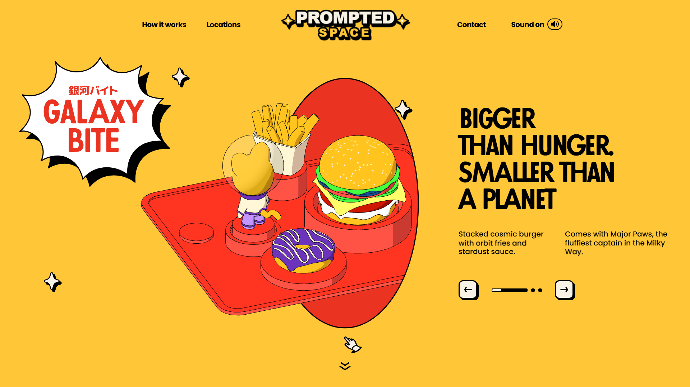

# PrompTedSpace — 3D Cosmic Fast Food Web Experience 🪐🍔

Reimagined and fully autonomous clone of the immersive 3D WebGL website **Planetoño**, rebranded for **PrompTedSite**.



## ✨ Fitur & Teknologi
- **Engine Grafis 3D**: Three.js WebGL dengan kompresi geometri Draco (`.wasm` decoder) dan cel-shading shaders custom.
- **Interaktivitas 2D**: Rive runtime canvas vector (`rive.wasm` + `rive.riv`) untuk logo, navigasi, dan interaksi sound toggle.
- **Sistem Audio Interaktif**: Web Audio API dengan ambient music background, click, hover, swoosh, dan map sound effects.
- **Headless CMS Offline**: Data Storyblok dimirror 100% lokal (`api_storyblok/global.json` & `home.json`) dengan runtime interceptor.
- **Smooth Scrolling**: Lenis & GSAP ScrollTrigger timeline.
- **100% Zero External Dependencies**: Semua font (Passata, Poppins), gambar, GLB, audio, dan script berjalan 100% offline tanpa dependensi server luar.

---

## 🚀 Cara Menjalankan Server Lokal

Pastikan Python 3 telah terinstall di komputer Anda.

1. **Jalankan Server Lokal**:
   ```bash
   python server.py
   ```
   *(Secara default server berjalan di `http://localhost:8888`)*

2. **Buka di Browser**:
   Buka `http://localhost:8888` di Chrome, Edge, atau Firefox.
   Klik tombol **START** untuk menyalakan audio imersif dan masuk ke pengalaman 3D!

---

## 📁 Struktur Proyek
```text
planetono/
├── site/                     # Direktori root web mandiri
│   ├── index.html            # Entry HTML dengan offline fetch interceptor
│   ├── _nuxt/                # Bundle Nuxt 3 & CSS chunks
│   ├── three/                # Model 3D GLB, kamera, cache geometri & tekstur
│   ├── sounds/               # Efek suara & ambient audio .mp3
│   ├── rive/                 # Rive WebAssembly & binary assets .riv
│   ├── draco/                # Draco mesh decoder wasm & wrapper
│   ├── lottie/               # Animasi vector Lottie JSON
│   ├── storyblok_assets/     # Gambar AVIF & favicon lokal
│   ├── api_storyblok/        # JSON payload konten lokal
│   └── fonts/                # Web fonts Passata & Poppins lokal
├── server.py                 # Server lokal Python dengan HTTP 206 Range streaming
├── rebrand_site.py           # Script otomatisasi rebranding
├── deep_rebrand.py           # Patch serialisasi Nuxt payload
├── inspect_planetono.py      # Inspeksi awal arsitektur
├── mirror_planetono.py       # Script scraping & downloading
└── README.md
```

---

© 2026 PrompTedSite Studio. All cosmic rights reserved.
